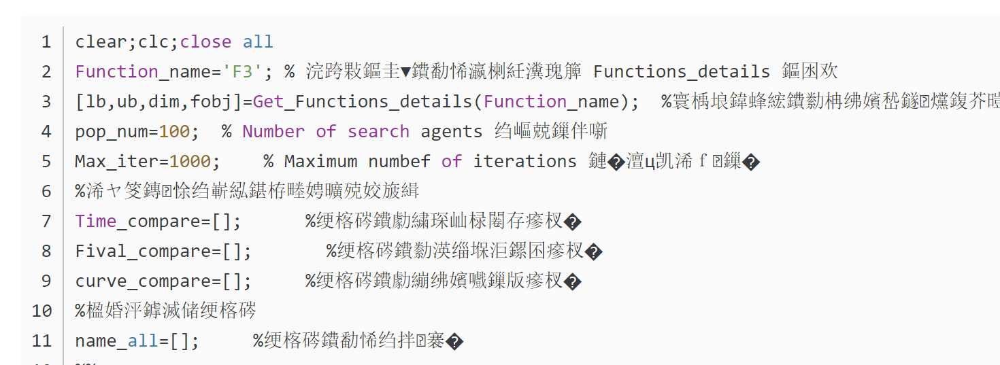

# Solving the Matlab Encoding Issues

When Matlab encounters garbled text, such as the following scenario:
\n        \n      Do not panic; follow the steps below:  
Solving the Chinese garbled text issue in Matlab, eliminating the need to upgrade Matlab versions.

## Images

<!-- PAYMENT_BLOCK -->

## Get this dataset

- Payment link (Stripe): [Buy now](https://buy.stripe.com/3cs8yP7sY87d0vu9AB)
- Payment QR code: 

<!-- /PAYMENT_BLOCK -->
